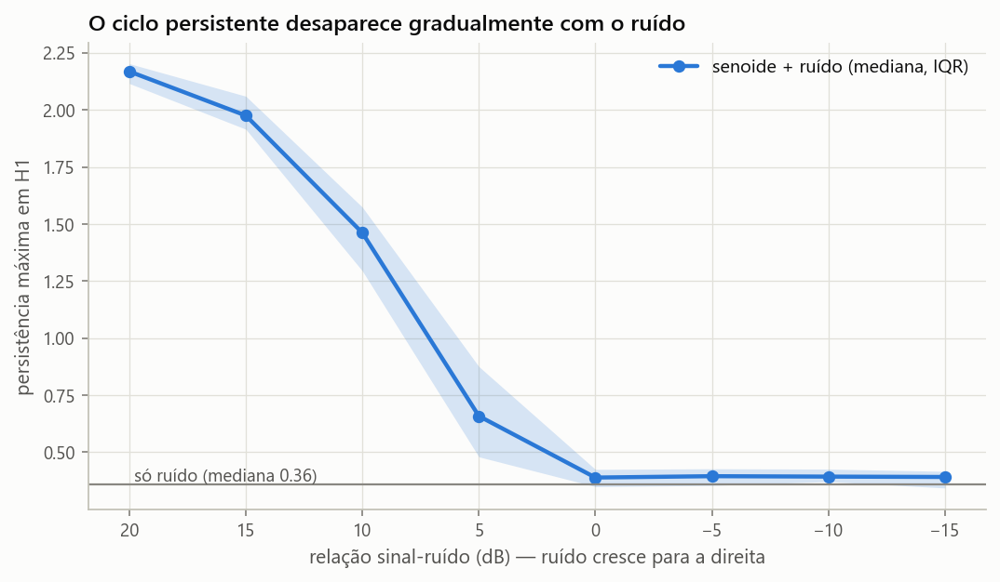
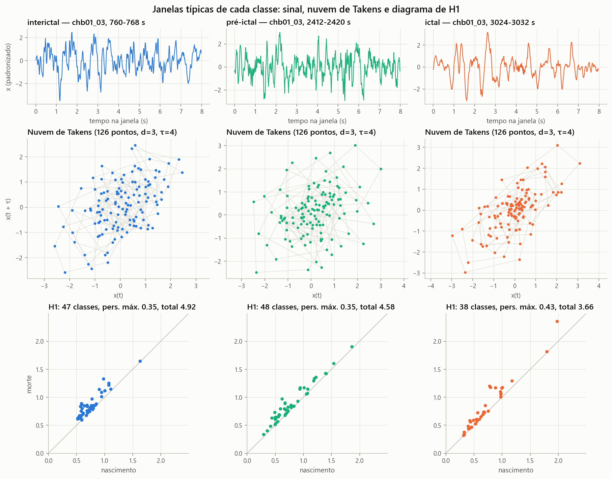
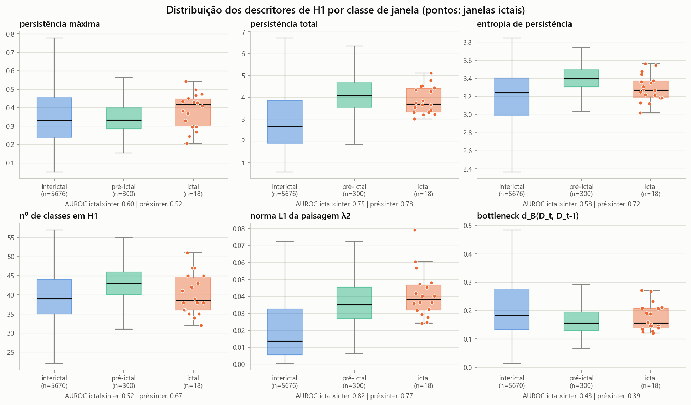
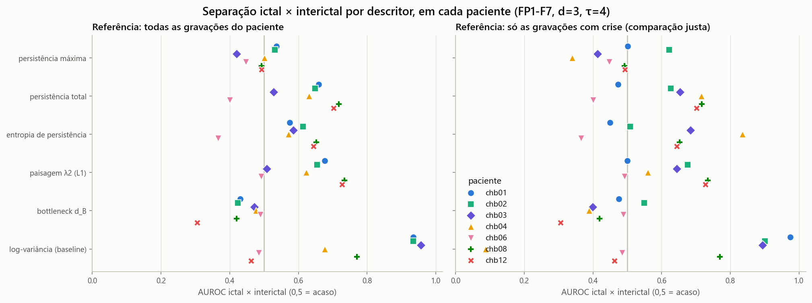
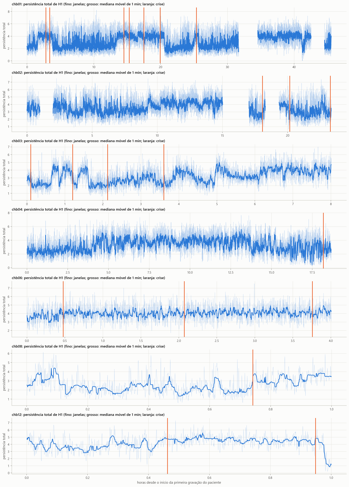
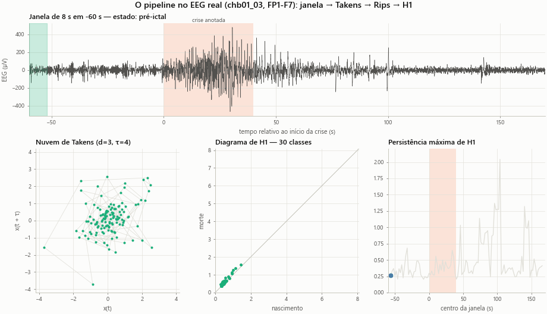

# Projeto 5 — EEG e crises epilépticas via Takens (TDA, SME0231/SME5987)

Implementação do Projeto 5 de `projetos_TDA.pdf`: reconstrução de Takens de um canal
de EEG do CHB-MIT, complexo de Vietoris–Rips por janela e persistência em H1,
comparada às anotações de crise.

**Pergunta de pesquisa.** A persistência de H1 da reconstrução de Takens muda
sistematicamente entre janelas interictais, pré-ictais e ictais, podendo servir de
descritor para detecção e, de forma exploratória, alerta antecipado?

**Resposta curta (com estes dados).** Não de forma útil. No canal FP1-F7 a
persistência máxima de H1 quase não distingue as janelas ictais das interictais
(AUROC 0,60), e um baseline simples de amplitude separa muito melhor (AUROC 0,84 a
0,97). Os descritores de H1 acompanham um estado lento do EEG que dura cerca de duas
horas e contém as duas crises, mas não o intervalo de 10 minutos que antecede cada
uma. O resultado se repete em três pacientes e nove crises, com treino e teste em
pacientes diferentes (itens 8 e 9). Detalhes e ressalvas na seção
[Resultados](#resultados).

> O enunciado foi atualizado depois do `projetos_TDA.pdf` guardado aqui: a versão nova
> traz uma seção "Definição supervisionada: amostras, rótulos e output". O item 9 dos
> resultados segue essa versão.

## Material de apresentação

- `projeto5_tda_eeg_colab.ipynb`: o projeto inteiro em um notebook comentado, com as saídas salvas
  (roda no Google Colab; a Seção 11 cobre os três pacientes e a definição supervisionada).
- `apresentacao_projeto5_tda.pptx`: slides, com notas do apresentador.

## Como executar

```
python -m pip install -r requirements.txt
python scripts/00_baixar_dados.py   # baixa 35 EDF do PhysioNet (1,5 GB) para dataset/
python executar_tudo.py             # 20 a 25 min; grava tudo em resultados/
```

Só a análise original do chb01 (7 EDF, 297 MB, 10 a 15 min): acrescente `--so-chb01`
aos dois comandos.

Os EDF não estão no repositório (são dados públicos do CHB-MIT); os resumos das crises
(`dataset/chbXX-summary.txt`) estão.

Cada etapa também roda sozinha: `python scripts/04_analise_temporal.py`. Os scripts
03 em diante leem o cache gerado pelo script 03.

## Dados

Pasta `dataset/`: 7 gravações de 1 h do paciente chb01 (256 Hz), com 2 crises
anotadas em `chb01-summary.txt`.

| Gravação | Início | Crise (s no arquivo) |
|---|---|---|
| chb01_01 | 11:42:54 | — |
| chb01_02 | 12:42:57 | — |
| chb01_03 | 13:43:04 | 2996–3036 (40 s) |
| chb01_04 | 14:43:12 | 1467–1494 (27 s) |
| chb01_05 | 15:43:19 | — |
| chb01_06 | 16:43:26 | — |
| chb01_09 | 19:43:56 | — |

A análise multipaciente (itens 8 e 9 dos resultados) usa também chb02 (gravações
01–19, 3 crises) e chb03 (gravações 01–08, 4 crises), com os mesmos parâmetros.

Janelas de 8 s com passo de 4 s: 6 293 no total (chb01).

| Classe | Definição | Janelas |
|---|---|---|
| ictal | ≥ 50 % da janela dentro da crise anotada | 18 |
| pré-ictal | termina nos 600 s anteriores ao início da crise | 300 |
| interictal | todo o resto | 5 676 |
| pós-ictal (excluída) | começa nos 600 s após o fim da crise | 297 |
| transição (excluída) | sobreposição parcial (< 50 %) com a crise | 2 |

## Do enunciado ao código

| Fase do enunciado | Onde | O que foi feito |
|---|---|---|
| 1. Carga | `tda_eeg/dados.py` | Leitura dos EDF com MNE; crises lidas do resumo; linha do tempo absoluta entre arquivos (o download do PhysioNet fica como alternativa em `baixar_edf`) |
| 2. Pré-processamento | `tda_eeg/dados.py`, `takens.py` | Canal FP1-F7, passa-faixa 1–30 Hz, reamostragem para 64 Hz, padronização de cada janela |
| 3. Takens | `tda_eeg/takens.py`, `scripts/02` | Imersão com d=3, τ=4 (enunciado); escolha de τ e d por autocorrelação, informação mútua e falsos vizinhos |
| 4. Topologia | `tda_eeg/topologia.py`, `scripts/03` | Vietoris–Rips (GUDHI, dimensão 2) até a maior distância; contagem de classes censuradas quando há truncamento |
| 5. Análise temporal | `scripts/04` | Persistência máxima e total, entropia, paisagens, nº de classes ao longo do tempo × anotações |
| Avançado: bottleneck | `scripts/03`, `04` | d_B(D_t, D_{t−1}) entre janelas consecutivas |
| Avançado: ML | `scripts/05` | Classificador ictal × não ictal, deixa-uma-gravação-fora, com baselines |
| Avançado: previsão | `scripts/06` | Horizonte pré-ictal, exclusão, alarmes falsos por hora e avaliação definidos formalmente |
| Avançado: Mapper | `scripts/07` | Kepler Mapper com lente topológica e com lente de tempo relativo à crise |
| Boas práticas | `scripts/01`, `08`, `executar_tudo.py` | Validação sintética, sensibilidade a canal e (d, τ), sementes fixas, `pip freeze` |
| "Diferentes janelas e pacientes" | `scripts/10`, `11` | Mesmo pipeline em chb01, chb02 e chb03; uma linha do tempo por paciente |
| Supervisionada: unidade amostral | `tda_eeg/dados.py`, `scripts/12` | Uma janela = paciente, arquivo, canal e intervalo absoluto |
| Supervisionada: rótulos | `scripts/12` | y=1 se a janela está totalmente contida na crise; y=0 se está a 1 h ou mais de qualquer crise; o resto fica sem rótulo |
| Supervisionada: três classes | `scripts/12` | Pré-ictal em [ts − 600 s, ts); saída com 3 probabilidades e classe prevista |
| Supervisionada: avaliação | `scripts/11`, `12` | Deixa-um-paciente-fora e teste cronológico no mesmo paciente; sensibilidade por crise, atraso de detecção, alarmes falsos/h, AUROC, AUPRC e prevalência |

## Resultados

Todas as figuras estão em `resultados/figuras/`, as tabelas em `resultados/tabelas/`.

### 1. O pipeline funciona em sinais com resposta conhecida

Uma senoide vira um laço no espaço de Takens, com um único ciclo dominante em H1
(persistência 2,25); ruído filtrado em 1–30 Hz fica em torno de 0,4. O ciclo deixa de
ser distinguível do ruído quando a relação sinal-ruído cai para 0 dB ou menos — o
regime em que o EEG de escalpo costuma estar.




### 2. Parâmetros de Takens

Em 30 trechos interictais de 60 s de chb01_01 (sem usar rótulos): a autocorrelação
cruza 1/e em 5 amostras (78 ms), o primeiro mínimo da informação mútua fica em
7 amostras (109 ms) e os falsos vizinhos caem abaixo de 10 % em d=4. A configuração
"pelos dados" é portanto d=4, τ=7; a do enunciado é d=3, τ=4. As duas foram
extraídas e a segunda não melhora nada (item 5).


### 3. H1 ao longo do tempo × anotações de crise





| Descritor de H1 | Mediana interictal | pré-ictal | ictal | AUROC ictal × inter. (todas) | AUROC ictal × inter. (mesmas gravações) |
|---|---|---|---|---|---|
| persistência máxima | 0,331 | 0,334 | 0,416 | 0,60 | 0,60 |
| persistência total | 2,66 | 4,06 | 3,70 | 0,75 | 0,49 |
| entropia de persistência | 3,24 | 3,40 | 3,27 | 0,58 | 0,37 |
| paisagem λ2 (norma L1) | 0,014 | 0,035 | 0,038 | 0,82 | 0,63 |
| bottleneck d_B(D_t, D_{t−1}) | 0,183 | 0,156 | 0,156 | 0,43 | 0,53 |
| *baseline:* log-variância | 7,87 | 6,36 | 9,05 | 0,84 | 0,97 |

- **Persistência máxima.** Sobe pouco durante a crise. A média no trecho ictal fica
  nos percentis 58 e 56 dos blocos interictais de mesma duração (p empírico 0,82 e
  0,87): um trecho interictal qualquer é igualmente "extremo".
- **Efeito de gravação.** Persistência total, entropia e paisagens parecem separar
  bem as classes quando a referência são todas as gravações, mas a separação some
  quando a referência é o interictal das mesmas gravações (0,75 → 0,49). Esses
  descritores mudam de nível a partir do minuto 35 de chb01_02 e voltam por volta do
  minuto 48 de chb01_04: um estado de cerca de 2 h que contém as duas crises. Sem
  hipnograma não dá para dizer o que é esse estado (sono é uma hipótese plausível).
- **Bottleneck.** Não marca o início das crises (percentis 32 e 47 entre janelas
  interictais) nem o fim (74 e 60).
- **Paisagem λ2** é o descritor topológico mais sensível: percentis 96 e 91 no teste
  por blocos (p 0,04 e 0,09), sem correção para os 16 descritores topológicos testados.
- **Picos de persistência máxima.** Na figura de detalhe há picos isolados 1 a 2 min
  depois do fim da crise, mas picos do mesmo tamanho aparecem nas gravações sem
  crise, e nos 10 min pós-ictais como um todo a AUROC contra o interictal das mesmas
  gravações é 0,55. Esses picos não indicam ritmo: nas 297 janelas acima do percentil
  95 interictal, o ciclo mais persistente nasce em escala maior que 2 em 93 % dos
  casos (mediana 3,2, contra 0,94 nas demais janelas). São ciclos formados por poucos
  pontos afastados do grosso da nuvem, isto é, transientes de grande amplitude dentro
  da janela. A persistência máxima do Rips é sensível a esse tipo de ponto atípico.


### 4. Detecção por aprendizado de máquina

Regressão logística, deixa-uma-gravação-fora, hiperparâmetros fixos, 18 janelas
ictais em 5 994.

| Descritores | AUROC | AUROC crise 1 | AUROC crise 2 | Alarmes falsos/h para detectar as 2 crises |
|---|---|---|---|---|
| Topológico H1 (d=3, τ=4) | 0,79 | 0,58 | 0,77 | 16,7 |
| Topológico H1 (d=4, τ=7) | 0,68 | 0,47 | 0,65 | 15,1 |
| Clássico: só forma | 0,88 | 0,71 | 0,93 | 3,6 |
| Clássico: forma + amplitude | 0,99 | 0,95 | 1,00 | 0,15 |
| Topológico + clássico | 0,98 | 0,92 | 1,00 | 0,15 |

Os descritores topológicos ficam abaixo até do baseline que, como eles, ignora a
amplitude ("só forma"), e não acrescentam nada ao baseline completo.


### 5. Sensibilidade a canal e a (d, τ)

A conclusão não depende da escolha de FP1-F7 nem de d=3, τ=4. Nos 21 canais, a
AUROC da persistência máxima (ictal × interictal das mesmas gravações) varia de 0,41
a 0,71; a da log-variância, de 0,89 a 0,98. Na grade d ∈ {2,…,5} × τ ∈ {2,…,14} ela
fica entre 0,40 e 0,70.


### 6. Previsão (exploratória)

Definições: horizonte pré-ictal de 600 s, tempo de intervenção 0 s, exclusão
pós-ictal de 600 s, escore suavizado por 60 s (causal), período refratário de 600 s,
alarme falso = alarme em janela interictal, 6,31 h interictais.

- Janela a janela, a AUROC pré-ictal × interictal é 0,80 com todas as gravações, mas
  0,56 e 0,58 **dentro** de cada gravação com crise: o escore não distingue os 10 min
  anteriores à crise do resto da mesma hora.
- No melhor limiar, as duas crises são "previstas" com 0,63 alarme falso por hora.
  Esse número é otimista por dois motivos: o limiar foi varrido nos próprios dados
  de teste, e o escore fica alto durante todo o estado de ~2 h, de modo que o alarme
  dispara a cada 10 min ao longo dele. As duas crises estão no mesmo estado, então
  contam na prática como um único evento.


### 7. Mapper (exploratório)

Com lente PCA 2D dos descritores de H1 (63 nós), nenhuma região do grafo concentra
janelas ictais (no máximo 2,4 % de um nó). O que organiza o grafo é o mesmo estado
das gravações 02–04. Com lente de tempo relativo à crise, o grafo é praticamente um
caminho, sem ramificação na crise. Versões interativas:
`resultados/mapper_A_interativo.html` e `mapper_B_interativo.html`.


### 8. Extensão multipaciente (chb01, chb02, chb03)

Mesmo pipeline e mesmos parâmetros (FP1-F7, d=3, τ=4, janelas de 8 s com passo de
4 s, mesmos rótulos), agora em 34 h de EEG de 3 pacientes com **9 crises** e 123
janelas ictais. Com mais de um paciente dá para fazer a divisão treino/teste **por
paciente** que o enunciado pede.

```
python scripts/10_multipaciente_extrair.py   # ~9 min; um cache por paciente
python scripts/11_multipaciente_analise.py   # ~1 min; saída em resultados/multipaciente/
```

| Paciente | Gravações | Horas | Crises | Janelas ictais |
|---|---|---|---|---|
| chb01 | 01–06, 09 | 7,0 | 2 | 18 |
| chb02 | 01–19 (com 16 e 16+) | 19,2 | 3 | 44 |
| chb03 | 01–08 | 8,0 | 4 | 61 |

O chb01 recalculado pelo código multipaciente é idêntico ao cache original
(diferença máxima 0).

**AUROC ictal × interictal das mesmas gravações** (comparação justa):

| Descritor | chb01 | chb02 | chb03 |
|---|---|---|---|
| persistência máxima | 0,60 | 0,62 | 0,41 |
| persistência total | 0,49 | 0,63 | 0,65 |
| paisagem λ2 (L1) | 0,63 | 0,68 | 0,64 |
| *baseline:* log-variância | 0,97 | 0,90 | 0,89 |

- A persistência máxima não se destaca em nenhuma das 9 crises: o trecho ictal fica
  entre os percentis 10 e 58 dos blocos interictais de mesma duração do paciente. No
  chb03 ela até **cai** na crise. A log-variância fica entre os percentis 95 e 100 nas 9.
- A paisagem λ2, o descritor mais promissor no chb01 (percentis 96 e 91), não se
  repete: fica entre 40 e 59 nas 4 crises do chb03.
- O "estado de 2 h" do chb01 não é um marcador geral. No chb02 há um platô parecido
  de persistência total (horas 9 a 15), mas nenhuma crise cai nele.

**Classificador (regressão logística), AUROC no paciente testado:**

| Descritores | Dentro do paciente (chb01 / 02 / 03) | Deixa-um-paciente-fora (chb01 / 02 / 03) |
|---|---|---|
| Topológico H1 | 0,79 / 0,58 / 0,56 | 0,73 / 0,62 / 0,58 |
| Clássico: só forma | 0,88 / 0,76 / 0,87 | 0,86 / 0,82 / 0,70 |
| Clássico: forma + amplitude | 0,99 / 0,92 / 0,99 | 0,99 / 0,98 / 0,98 |
| Topológico + clássico | 0,98 / 0,90 / 0,99 | 0,98 / 0,98 / 0,98 |

Para detectar todas as crises do paciente testado, o modelo topológico dispara de 40 a
136 alarmes falsos por hora entre pacientes; o clássico completo, de 0,4 a 2,5.

A conclusão do chb01 se mantém e fica mais forte: com três pacientes e nove crises,
H1 da reconstrução de Takens continua perto do acaso e abaixo do baseline que também
ignora a amplitude. Somar a topologia ao baseline completo não muda a AUROC. A AUPRC,
mais sensível com classes tão desbalanceadas, sobe um pouco nos três pacientes no
esquema entre pacientes (0,46 → 0,52; 0,15 → 0,20; 0,47 → 0,63); com nove crises isso é
um indício a conferir com mais dados, não um resultado.

Ressalvas: o chb03 tem 7 crises e só as 4 das gravações 01–08 entraram; a crise de
chb02_19 dura 9 s (2 janelas ictais) e a gravação seguinte (chb02_20) não está na
base local, então o pós-ictal dela fica truncado.






### 9. Definição supervisionada do enunciado (rótulos estritos, avaliação por evento)

```
python scripts/12_avaliacao_supervisionada.py   # ~1 min; usa os caches do script 10
```

Os itens 1 a 8 usam os rótulos fixados no início do projeto (ictal = pelo menos metade
da janela na crise; interictal = tudo fora das faixas de 10 min). O script 12 refaz a
detecção com a versão recomendada no enunciado:

| Rótulo | Regra | Janelas (chb01 / 02 / 03) |
|---|---|---|
| ictal (y=1) | janela totalmente contida na crise anotada | 14 / 38 / 53 |
| interictal (y=0) | a 1 h ou mais de qualquer crise do paciente | 3 973 / 13 599 / 3 044 |
| pré-ictal (só na extensão de 3 classes) | janela contida em [ts − 600 s, ts) | 297 / 442 / 531 |
| sem rótulo | cruza o início ou o fim da crise, pós-ictal, interictal próximo | fora do treino e das métricas por janela |

O limiar de alarme é **fixado no treino**: o valor que deixa passar 1 % (ou 0,1 %) das
janelas negativas de treino. Com passo de 4 s, 1 % equivale a cerca de 9 janelas
positivas por hora.

**Entre pacientes (deixa-um-paciente-fora), 9 crises no teste:**

| Descritores | AUROC (chb01 / 02 / 03) | Crises detectadas, 1 % | Alarmes falsos/h, 1 % | Crises detectadas, 0,1 % | Alarmes falsos/h, 0,1 % |
|---|---|---|---|---|---|
| Topológico H1 | 0,77 / 0,61 / 0,44 | 2 de 9 | 3,9 / 12,5 / 9,2 | 0 de 9 | 0,5 / 0,9 / 2,4 |
| Clássico: só forma | 0,90 / 0,79 / 0,76 | 4 de 9 | 3,4 / 33,2 / 2,4 | 0 de 9 | 0,0 / 3,3 / 0,3 |
| Clássico: forma + amplitude | 0,99 / 0,99 / 1,00 | 9 de 9 | 31,7 / 7,3 / 0,0 | 8 de 9 | 0,9 / 2,9 / 0,0 |
| Topológico + clássico | 1,00 / 0,99 / 1,00 | 9 de 9 | 32,4 / 24,3 / 0,3 | 9 de 9 | 1,4 / 2,9 / 0,0 |

- O modelo topológico detecta 2 das 9 crises no ponto de 1 % e nenhuma no de 0,1 %.
- **A AUROC por janela engana.** O clássico completo tem AUROC de 0,99 no chb01 e
  dispara 32 alarmes falsos por hora no ponto de 1 %: o limiar veio dos outros dois
  pacientes e a amplitude do EEG muda de pessoa para pessoa.
- O atraso mediano de detecção do clássico completo fica entre 5 e 29 s.
- Com a topologia somada ao clássico, a crise que faltava no ponto de 0,1 % é detectada
  e a AUPRC sobe (0,45 → 0,60; 0,10 → 0,48; 0,98 → 0,99), mas os alarmes falsos do chb02
  no ponto de 1 % triplicam. O efeito é pequeno e misto; ver a ressalva do item 8.

**Cronológica, no mesmo paciente** (treino até a gravação da crise ⌊n/2⌋, teste nas
posteriores):

| Paciente | Crises no teste | Topológico H1 | Clássico: forma + amplitude |
|---|---|---|---|
| chb01 | 1 | AUROC 0,92; 0 de 1 detectada | AUROC 0,99; 1 de 1; 27 alarmes falsos/h (1 %) e 8 (0,1 %) |
| chb02 | 2 | AUROC 0,73; 0 de 2 | AUROC 0,94; 2 de 2; 16 alarmes falsos/h (1 %) e 7 (0,1 %) |
| chb03 | 2 | não avaliável | não avaliável |

- No chb01 a AUROC topológica de 0,92 vem do estado lento do item 3: com o interictal
  restrito a janelas afastadas, a comparação volta a ser entre horas diferentes. Mesmo
  assim a crise não é detectada.
- O chb03 não é avaliável neste esquema: as gravações de treino (01 e 02) têm crise e
  nenhuma janela delas fica a 1 h de uma crise. A regra não foi afrouxada depois de
  ver os dados.

**Três classes, entre pacientes.** Acurácia balanceada (acaso = 0,33): topológico de
0,28 a 0,36; clássico completo de 0,49 a 0,59, porque acerta a classe ictal. A AUROC
de "pré-ictal × resto" vai de 0,14 a 0,68 com a topologia e de 0,17 a 0,41 com o
baseline: o que se aprende como pré-ictal em dois pacientes não vale no terceiro. Não
há evidência de antecipação.

As saídas por janela (escore e classe prevista; 3 probabilidades na extensão) ficam em
`resultados/multipaciente/tabelas/saida_*_por_janela.csv.gz`.


## Animações

- `resultados/animacoes/animacao_filtracao_rips.gif` — as bolas crescem, surgem
  arestas e triângulos e o código de barras de H1 é desenhado junto (sinal sintético,
  d=2, 43 pontos, para caber no plano).
- `resultados/animacoes/animacao_janela_deslizante.gif` — o pipeline no EEG real em
  torno da crise de chb01_03: janela → nuvem de Takens → diagrama → persistência máxima.
- `resultados/figuras/09_filtracao_quadro{1..4}.png` — quadros-chave para slides.




## Limitações

- **Três pacientes, nove crises.** Nada aqui é confirmatório; o CHB-MIT tem 24 casos.
  Os itens 1 a 7 usam só o chb01, com divisão por gravação (generalização para outras
  horas do mesmo paciente); a divisão por paciente está nos itens 8 e 9. A previsão
  com alarmes (item 6) e o Mapper (item 7) continuam só no chb01.
- **Janelas correlacionadas.** Janelas vizinhas se sobrepõem em 50 %; por isso os
  resultados são dados como AUROC e percentis de blocos, não como valores-p de testes
  que supõem independência. A faixa de erro das paisagens médias é otimista.
- **"Interictal" frouxo nos itens 1 a 8.** Qualquer janela fora das faixas
  pré/pós-ictais conta como interictal. O item 9 exige 1 h de distância, ainda menos
  que as 4 h comuns na literatura.
- **Um canal por vez.** A crise pode ter foco longe do canal analisado; o item 5
  cobre os outros canais só de forma univariada.
- **Nuvens de 126 pontos** (subamostragem de 4): ciclos mais finos que isso não são
  resolvidos.
- **Sem rejeição de artefatos.** Piscadas e movimentos entram nas janelas e geram
  pontos atípicos na nuvem; um próximo passo natural seria remover artefatos ou usar
  uma filtração robusta a outliers (por exemplo, distância à medida) antes de H1.

## Reprodutibilidade

Semente única em `tda_eeg/config.py`; parâmetros fixados antes de qualquer métrica de
desempenho; versões em `requirements.txt` e `resultados/pip_freeze.txt`; saída de cada
etapa em `resultados/registro_execucao.txt`. A varredura de sensibilidade usa o
Ripser em vez do GUDHI por velocidade; os dois dão a mesma persistência (diferença
máxima 3×10⁻⁷ em 60 janelas).
