# A topologia do EEG muda em uma crise epiléptica?

**Projeto 5 de Análise Topológica de Dados (SME0231/SME5987).** Reconstrução de Takens
de um canal de EEG, complexo de Vietoris–Rips por janela e homologia persistente em H1,
aplicados ao banco público CHB-MIT e comparados às anotações de crise.

## A pergunta e a resposta

Uma crise epiléptica costuma aparecer no EEG como atividade rítmica. Um sinal rítmico
vira um laço no espaço de Takens, e laços são o que H1 mede. A pergunta do projeto:

> A persistência de H1 da reconstrução de Takens muda sistematicamente entre janelas
> interictais (longe da crise), pré-ictais (pouco antes) e ictais (durante a crise),
> podendo servir de descritor para detecção e, de forma exploratória, alerta antecipado?

**Resposta, com sete pacientes e 21 crises: sozinha, não.** Treinando um classificador
em seis pacientes e testando no sétimo:

| Descritores | Crises detectadas | No limiar mais rígido |
|---|---|---|
| Só topologia (H1), 1 canal | 4 de 21 | 0 de 21 |
| Só topologia (H1), 21 canais | 12 de 21 | 0 de 21 |
| Clássico com amplitude, 1 canal | 18 de 21 | 13 de 21 |
| Topologia + clássico, 1 canal | 21 de 21 | 16 de 21 |
| Clássico com amplitude, 21 canais | 21 de 21 | 21 de 21 |

- **H1 não destaca nenhuma das 21 crises.** O trecho da crise fica entre os percentis
  10 e 68 dos trechos interictais do mesmo paciente.
- **A crise muda o sinal, mas não cria um laço.** A nuvem de Takens de uma janela de
  crise é um novelo, sem buraco; o que muda é a amplitude, que a padronização de cada
  janela apaga.
- **A amplitude de um canal também não é universal.** Ela destaca 15 das 21 crises e
  falha em três pacientes, nos quais a crise quase não aparece no canal analisado.
- **Somada ao baseline clássico, a topologia não é redundante.** Ela recupera as três
  crises que o baseline de um canal perde, e um controle com os descritores
  embaralhados mostra que o ganho não vem de ter mais colunas.
- **O que parecia sinal era um estado do cérebro.** A persistência total acompanha um
  estado de horas, provavelmente o sono, em que caem as 7 crises do paciente chb01.
- **Não há evidência de antecipação**: a classe pré-ictal não se transfere entre pacientes.

**Expectativa × realidade.** Em cima, o que a hipótese previa; embaixo, o EEG real
durante uma crise.

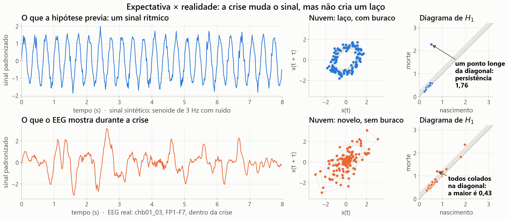

**As 21 crises, uma por linha.** Quão incomum é o trecho da crise entre trechos
interictais do mesmo paciente: bolinhas azuis para a topologia, losangos laranja para
a amplitude.

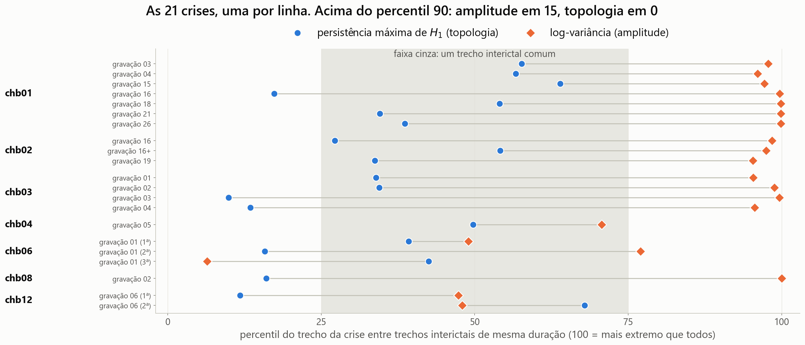

**Treino e teste em pacientes diferentes.** Cada bolinha é uma crise; cheia quer dizer
detectada.

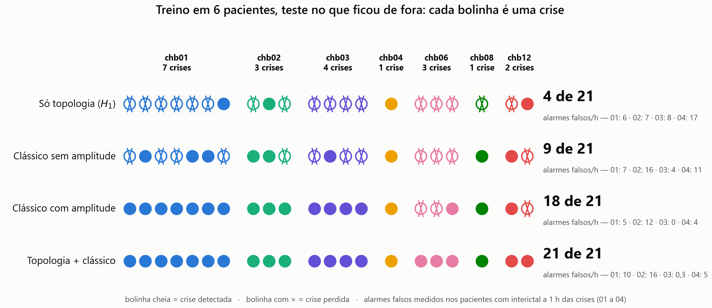

O trabalho tem duas partes. O **estudo de caso** (itens 1 a 7 dos resultados) examina a
fundo 7 horas de um paciente, com 2 crises, e é o que o enunciado pede. A **análise com
sete pacientes** (itens 8 a 11) repete o pipeline em 92 horas e 21 crises, com treino e
teste em pacientes diferentes. Detalhes e ressalvas na seção [Resultados](#resultados).

> O enunciado foi atualizado depois do `projetos_TDA.pdf` guardado aqui: a versão nova
> traz uma seção "Definição supervisionada: amostras, rótulos e output". O item 9 dos
> resultados segue essa versão.

## Tópicos avançados em destaque

O enunciado lista quatro tópicos avançados. Os dois abaixo recebem mais atenção; a
distância de bottleneck e a previsão estão nos itens 3 e 6 dos resultados.

### Machine Learning: os descritores de H1 como entrada de um classificador

**O que o enunciado pede.** Usar as características topológicas de cada janela como
entrada de modelos de classificação, com a divisão treino/teste **por paciente** sempre
que o objetivo for avaliar generalização para novos indivíduos.

**Como foi feito.** Cada janela de 8 s vira 15 números tirados do diagrama de H1
(persistência máxima e total, número de barras, entropia, normas das paisagens). Eles
entram em uma regressão logística com hiperparâmetros fixos, que devolve um escore de
crise. O modelo é sempre testado em dados que não viu: uma gravação inteira de fora no
estudo de caso, um paciente inteiro de fora na análise com sete pacientes. O limiar do
alarme é fixado no treino, e a comparação é com 12 descritores clássicos de EEG, sem
topologia.

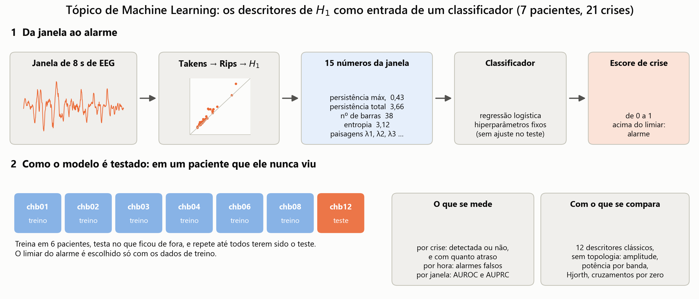

**O que deu.**

| Descritores | Estudo de caso: AUROC | Sete pacientes: crises detectadas | Sete pacientes, 21 canais |
|---|---|---|---|
| Só topologia (H1) | 0,79 | 4 de 21 | 12 de 21 |
| Clássico sem amplitude | 0,88 | 9 de 21 | 14 de 21 |
| Clássico com amplitude | 0,99 | 18 de 21 | 21 de 21 |
| Topologia + clássico | 0,98 | 21 de 21 | 21 de 21 |

- **Sozinha, a topologia não serve de detector.** Fica abaixo até do baseline que, como
  ela, ignora a amplitude.
- **O limite está nos descritores, não no modelo nem na quantidade de dados.** Modelos
  mais flexíveis (floresta aleatória, gradient boosting) decoram o treino (AUROC de
  0,96 a 1,00) e ficam em 0,61 a 0,62 no paciente novo, contra 0,67 da regressão
  logística. Treinar com 10 % ou com 100 % das janelas de crise quase não muda o
  resultado (0,65 → 0,67).
- **Somada ao baseline, ela não é redundante.** Recupera as três crises que o baseline
  de um canal perde, e a AUPRC sobe nos quatro pacientes em que dá para medir. Com os
  descritores topológicos embaralhados o ganho some, então ele não vem de ter mais colunas.
- **A AUROC por janela engana.** Com 0,4 % de janelas de crise, um modelo com AUROC de
  0,99 ainda dispara vários alarmes falsos por hora em um paciente novo. Por isso os
  resultados são dados por crise e por hora.

Código: `scripts/05` (estudo de caso), `11` e `12` (por paciente, rótulos e métricas do
enunciado), `14` (21 canais) e `15` (modelos mais flexíveis e curva de aprendizado).
Detalhes nos itens 4, 8, 9 e 11 dos resultados.

### Mapper: o grafo das janelas

**O que o enunciado pede.** Aplicar o Kepler Mapper ao conjunto de janelas, usando o
tempo relativo ao início da crise ou descritores topológicos como lente.

**Como foi feito.** Cada janela é um ponto descrito pelos 15 números de H1. A lente são
as duas primeiras componentes principais desses descritores; o plano é coberto por
12 × 12 quadrados com 40 % de sobreposição; dentro de cada quadrado as janelas parecidas
são agrupadas (DBSCAN), e cada grupo vira um nó. Dois nós são ligados quando têm janelas
em comum.

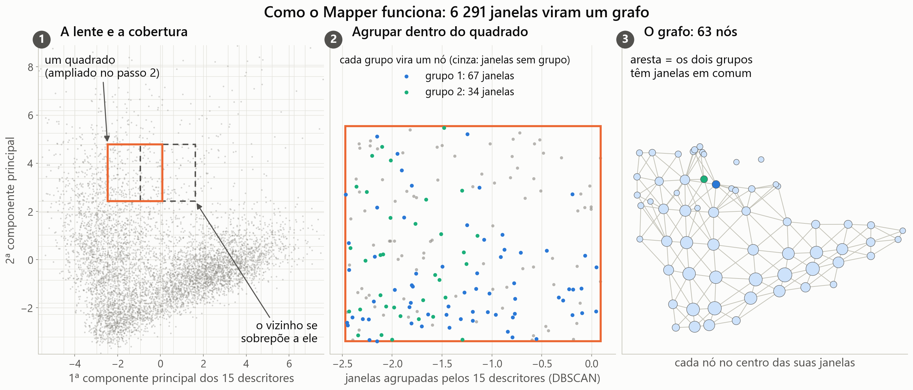

**O que deu.** A pergunta feita ao grafo é se existe um nó ou um ramo onde as janelas
de crise se concentram. Não existe.

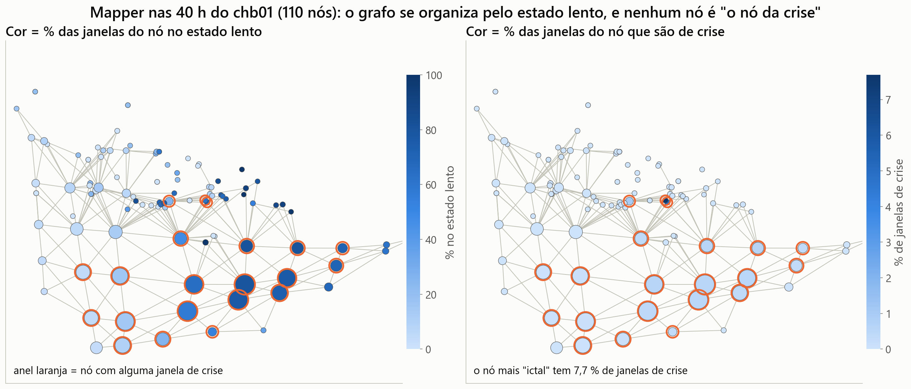

- **Nas 40 h do chb01** (36 446 janelas, 7 crises, 110 nós), o nó mais "ictal" tem 7,7 %
  de janelas de crise. As janelas de crise ficam espalhadas por 21 nós, misturadas a
  milhares de janelas interictais.
- **O que organiza o grafo é o estado lento** (item 10), não a crise: das 113 janelas
  de crise que entraram no grafo, 110 estão em nós em que a maioria das janelas é desse
  estado.
- **No estudo de caso** (6 291 janelas, 63 nós), o nó mais ictal tem 2,4 %. Com a outra
  lente sugerida no enunciado, o tempo relativo ao início da crise, o grafo é
  praticamente um caminho, sem ramificação na crise.

O Mapper chega, por outro caminho, à mesma conclusão da análise temporal: os
descritores topológicos enxergam o estado do cérebro, não a crise.

Código: `scripts/07` (estudo de caso, com as versões interativas
`resultados/mapper_A_interativo.html` e `mapper_B_interativo.html`) e `scripts/13`
(figuras e o Mapper nas 40 h). Detalhes no item 7 dos resultados.

## Material de apresentação

- `projeto5_tda_eeg_colab.ipynb`: o projeto inteiro em um notebook comentado, com as saídas salvas
  (roda no Google Colab; a Seção 11 cobre os três primeiros pacientes, chb01 a chb03, com 14
  crises, e a definição supervisionada; os sete pacientes estão nos scripts 10 a 14).
- `apresentacao_projeto5_tda.pptx`: slides, com notas do apresentador.

## Como executar

```
python -m pip install -r requirements.txt
python scripts/00_baixar_dados.py   # baixa 78 EDF do PhysioNet (3,7 GB) para dataset/
python executar_tudo.py             # 50 a 60 min; grava tudo em resultados/
```

Só o estudo de caso do chb01 (7 EDF, 297 MB, 10 a 15 min): acrescente `--so-chb01`
aos dois comandos. O estudo de caso (itens 1 a 7) usa sempre as mesmas 7 gravações,
listadas em `tda_eeg/config.py`, mesmo que a pasta tenha o paciente inteiro.

Os EDF não estão no repositório (são dados públicos do CHB-MIT); os resumos das crises
(`dataset/chbXX-summary.txt`) estão.

Cada etapa também roda sozinha: `python scripts/04_analise_temporal.py`. Os scripts
03 em diante leem o cache gerado pelo script 03.

## Dados

**Estudo de caso.** 7 gravações de 1 h do paciente chb01 (256 Hz), com 2 crises
anotadas em `dataset/chb01-summary.txt`.

| Gravação | Início | Crise (s no arquivo) |
|---|---|---|
| chb01_01 | 11:42:54 | — |
| chb01_02 | 12:42:57 | — |
| chb01_03 | 13:43:04 | 2996–3036 (40 s) |
| chb01_04 | 14:43:12 | 1467–1494 (27 s) |
| chb01_05 | 15:43:19 | — |
| chb01_06 | 16:43:26 | — |
| chb01_09 | 19:43:56 | — |

Janelas de 8 s com passo de 4 s: 6 293 no estudo de caso.

| Classe | Definição | Janelas |
|---|---|---|
| ictal | ≥ 50 % da janela dentro da crise anotada | 18 |
| pré-ictal | termina nos 600 s anteriores ao início da crise | 300 |
| interictal | todo o resto | 5 676 |
| pós-ictal (excluída) | começa nos 600 s após o fim da crise | 297 |
| transição (excluída) | sobreposição parcial (< 50 %) com a crise | 2 |

**Sete pacientes.** Mesmos parâmetros e mesmos rótulos, em 92 h de EEG com 21 crises
(83 147 janelas, 310 delas ictais):

| Paciente | Gravações | Horas | Crises |
|---|---|---|---|
| chb01 | todas as 42 | 40,5 | 7 |
| chb02 | 01–19 (com 16 e 16+) | 19,2 | 3 |
| chb03 | 01–08 | 8,0 | 4 |
| chb04 | 01–05 | 18,6 | 1 |
| chb06 | 01 | 4,0 | 3 |
| chb08 | 02 | 1,0 | 1 |
| chb12 | 06 | 1,0 | 2 |

## Do enunciado ao código

| Fase do enunciado | Onde | O que foi feito |
|---|---|---|
| 1. Carga | `tda_eeg/dados.py` | Leitura dos EDF com MNE; crises lidas do resumo; linha do tempo absoluta entre arquivos (o download do PhysioNet fica como alternativa em `baixar_edf`) |
| 2. Pré-processamento | `tda_eeg/dados.py`, `takens.py` | Canal FP1-F7, passa-faixa 1–30 Hz, reamostragem para 64 Hz, padronização de cada janela |
| 3. Takens | `tda_eeg/takens.py`, `scripts/02` | Imersão com d=3, τ=4 (enunciado); escolha de τ e d por autocorrelação, informação mútua e falsos vizinhos |
| 4. Topologia | `tda_eeg/topologia.py`, `scripts/03` | Vietoris–Rips (GUDHI, dimensão 2) até a maior distância; contagem de classes censuradas quando há truncamento |
| 5. Análise temporal | `scripts/04` | Persistência máxima e total, entropia, paisagens, nº de classes ao longo do tempo × anotações |
| Avançado: bottleneck | `scripts/03`, `04` | d_B(D_t, D_{t−1}) entre janelas consecutivas |
| Avançado: ML | `scripts/05`, `11`, `12`, `14`, `15` | Classificador ictal × não ictal com baselines; deixa-uma-gravação-fora no estudo de caso e deixa-um-paciente-fora com sete pacientes |
| Avançado: previsão | `scripts/06` | Horizonte pré-ictal, exclusão, alarmes falsos por hora e avaliação definidos formalmente |
| Avançado: Mapper | `scripts/07`, `13` | Kepler Mapper com lente topológica e com lente de tempo relativo à crise; repetido nas 40 h do chb01 |
| Boas práticas | `scripts/01`, `08`, `executar_tudo.py` | Validação sintética, sensibilidade a canal e (d, τ), sementes fixas, `pip freeze` |
| "Diferentes janelas e pacientes" | `scripts/10`, `11` | Mesmo pipeline em sete pacientes; uma linha do tempo por paciente |
| Figuras para a apresentação | `scripts/13` | Nove figuras didáticas, com a leitura escrita na própria figura |
| Além do enunciado: vários canais | `scripts/14` | O mesmo pipeline nos 21 canais, com os descritores juntos no modelo |
| Supervisionada: unidade amostral | `tda_eeg/dados.py`, `scripts/12` | Uma janela = paciente, arquivo, canal e intervalo absoluto |
| Supervisionada: rótulos | `scripts/12` | y=1 se a janela está totalmente contida na crise; y=0 se está a 1 h ou mais de qualquer crise; o resto fica sem rótulo |
| Supervisionada: três classes | `scripts/12` | Pré-ictal em [ts − 600 s, ts); saída com 3 probabilidades e classe prevista |
| Supervisionada: avaliação | `scripts/11`, `12` | Deixa-um-paciente-fora e teste cronológico no mesmo paciente; sensibilidade por crise, atraso de detecção, alarmes falsos/h, AUROC, AUPRC e prevalência |

## Resultados

Os itens 1 a 7 são o **estudo de caso** (7 h do chb01, 2 crises); figuras em
`resultados/figuras/` e tabelas em `resultados/tabelas/`. Os itens 8 a 11 são a
**análise com sete pacientes**; figuras e tabelas em `resultados/multipaciente/` e
`resultados/didaticas/`.

### 1. O pipeline funciona em sinais com resposta conhecida

Uma senoide vira um laço no espaço de Takens, com um único ciclo dominante em H1
(persistência 2,25); ruído filtrado em 1–30 Hz fica em torno de 0,4. O ciclo deixa de
ser distinguível do ruído quando a relação sinal-ruído cai para 0 dB ou menos — o
regime em que o EEG de escalpo costuma estar.

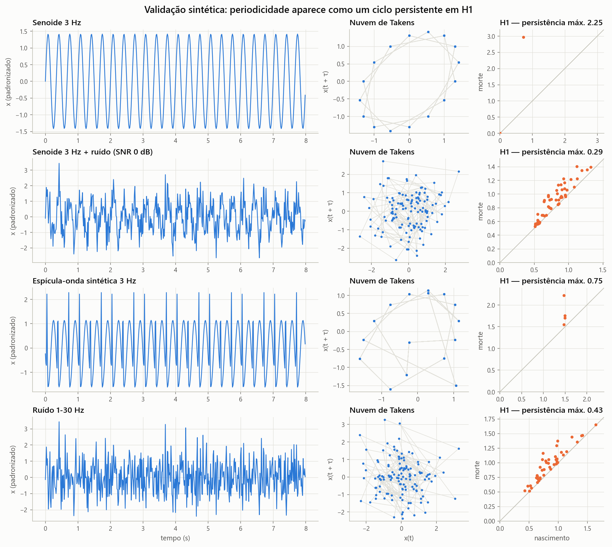


### 2. Parâmetros de Takens

Em 30 trechos interictais de 60 s de chb01_01 (sem usar rótulos): a autocorrelação
cruza 1/e em 5 amostras (78 ms), o primeiro mínimo da informação mútua fica em
7 amostras (109 ms) e os falsos vizinhos caem abaixo de 10 % em d=4. A configuração
"pelos dados" é portanto d=4, τ=7; a do enunciado é d=3, τ=4. As duas foram
extraídas e a segunda não melhora nada (item 5).

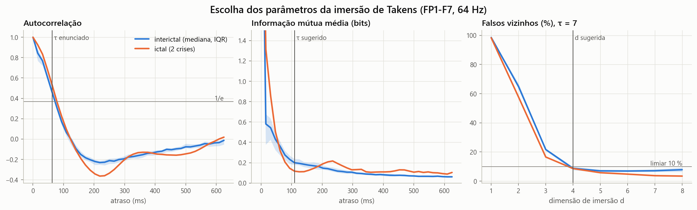

### 3. H1 ao longo do tempo × anotações de crise

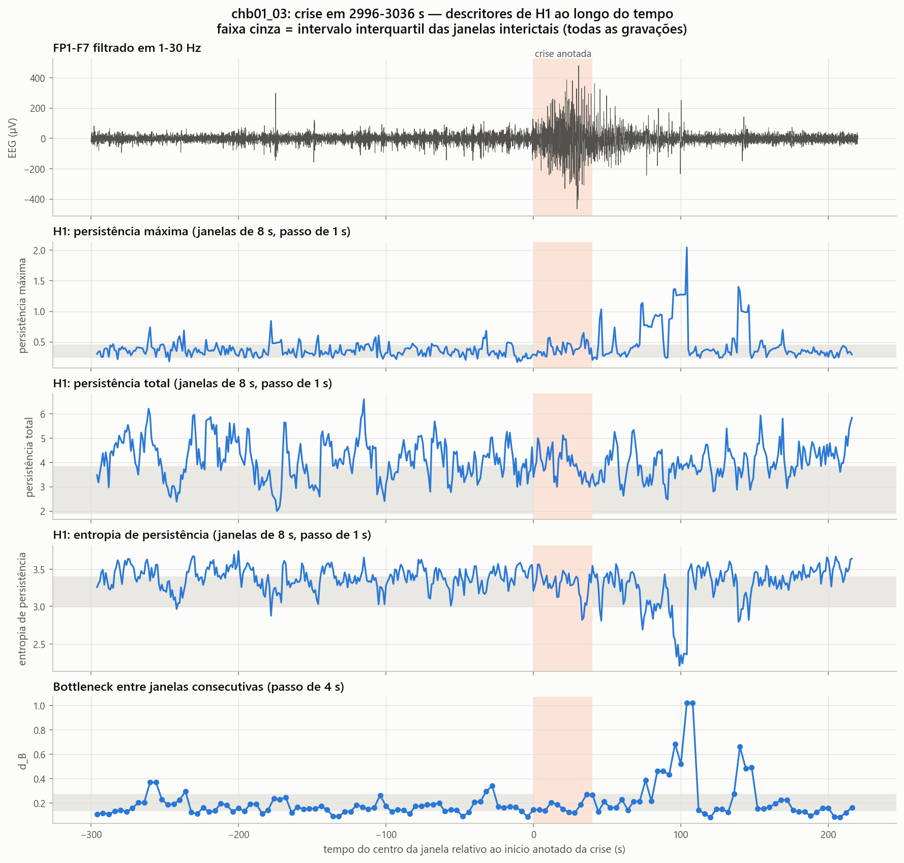


| Descritor de H1 | Mediana interictal | pré-ictal | ictal | AUROC ictal × inter. (todas) | AUROC ictal × inter. (mesmas gravações) |
|---|---|---|---|---|---|
| persistência máxima | 0,331 | 0,334 | 0,416 | 0,60 | 0,60 |
| persistência total | 2,66 | 4,06 | 3,70 | 0,75 | 0,49 |
| entropia de persistência | 3,24 | 3,40 | 3,27 | 0,58 | 0,37 |
| paisagem λ2 (norma L1) | 0,014 | 0,035 | 0,038 | 0,82 | 0,63 |
| bottleneck d_B(D_t, D_{t−1}) | 0,183 | 0,156 | 0,156 | 0,43 | 0,53 |
| *baseline:* log-variância | 7,87 | 6,36 | 9,05 | 0,84 | 0,97 |

- **Persistência máxima.** Sobe pouco durante a crise. A média no trecho ictal fica
  nos percentis 58 e 56 dos blocos interictais de mesma duração (p empírico 0,82 e
  0,87): um trecho interictal qualquer é igualmente "extremo".
- **Efeito de gravação.** Persistência total, entropia e paisagens parecem separar
  bem as classes quando a referência são todas as gravações, mas a separação some
  quando a referência é o interictal das mesmas gravações (0,75 → 0,49). Esses
  descritores mudam de nível a partir do minuto 35 de chb01_02 e voltam por volta do
  minuto 48 de chb01_04: um estado de cerca de 2 h que contém as duas crises. Sem
  hipnograma não dá para dizer o que é esse estado (sono é uma hipótese plausível).
- **Bottleneck.** Não marca o início das crises (percentis 32 e 47 entre janelas
  interictais) nem o fim (74 e 60).
- **Paisagem λ2** é o descritor topológico mais sensível: percentis 96 e 91 no teste
  por blocos (p 0,04 e 0,09), sem correção para os 16 descritores topológicos testados.
- **Picos de persistência máxima.** Na figura de detalhe há picos isolados 1 a 2 min
  depois do fim da crise, mas picos do mesmo tamanho aparecem nas gravações sem
  crise, e nos 10 min pós-ictais como um todo a AUROC contra o interictal das mesmas
  gravações é 0,55. Esses picos não indicam ritmo: nas 297 janelas acima do percentil
  95 interictal, o ciclo mais persistente nasce em escala maior que 2 em 93 % dos
  casos (mediana 3,2, contra 0,94 nas demais janelas). São ciclos formados por poucos
  pontos afastados do grosso da nuvem, isto é, transientes de grande amplitude dentro
  da janela. A persistência máxima do Rips é sensível a esse tipo de ponto atípico.

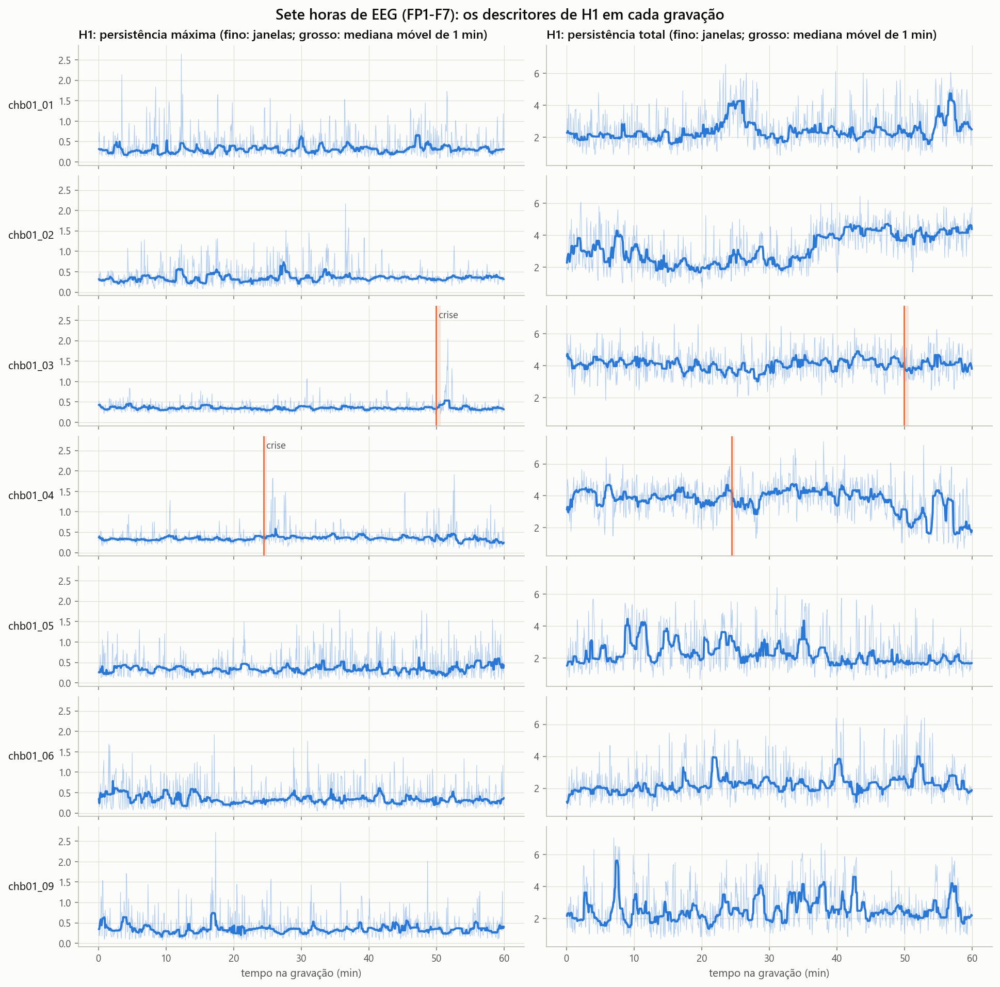
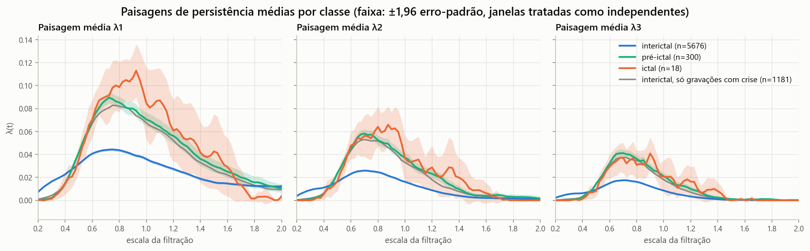

### 4. Detecção por aprendizado de máquina

Regressão logística, deixa-uma-gravação-fora, hiperparâmetros fixos, 18 janelas
ictais em 5 994.

| Descritores | AUROC | AUROC crise 1 | AUROC crise 2 | Alarmes falsos/h para detectar as 2 crises |
|---|---|---|---|---|
| Topológico H1 (d=3, τ=4) | 0,79 | 0,58 | 0,77 | 16,7 |
| Topológico H1 (d=4, τ=7) | 0,68 | 0,47 | 0,65 | 15,1 |
| Clássico: só forma | 0,88 | 0,71 | 0,93 | 3,6 |
| Clássico: forma + amplitude | 0,99 | 0,95 | 1,00 | 0,15 |
| Topológico + clássico | 0,98 | 0,92 | 1,00 | 0,15 |

Os descritores topológicos ficam abaixo até do baseline que, como eles, ignora a
amplitude ("só forma"), e não acrescentam nada ao baseline completo.

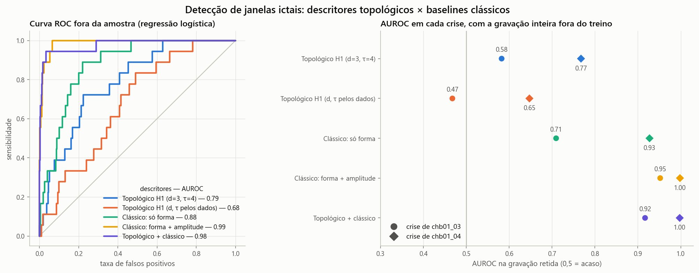

### 5. Sensibilidade a canal e a (d, τ)

A conclusão não depende da escolha de FP1-F7 nem de d=3, τ=4. Nos 21 canais, a
AUROC da persistência máxima (ictal × interictal das mesmas gravações) varia de 0,41
a 0,71; a da log-variância, de 0,89 a 0,98. Na grade d ∈ {2,…,5} × τ ∈ {2,…,14} ela
fica entre 0,40 e 0,70.

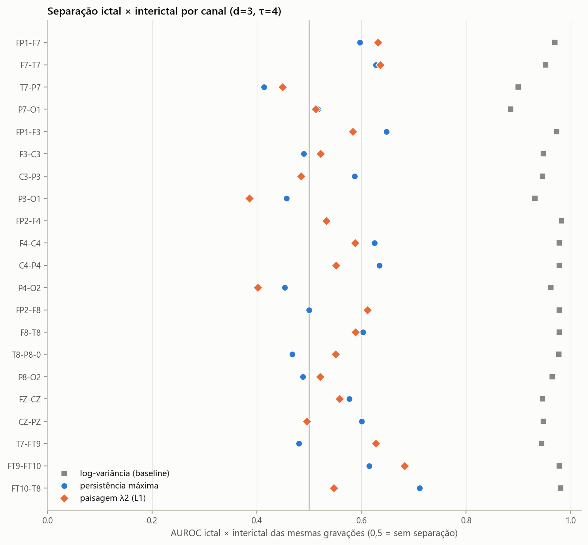
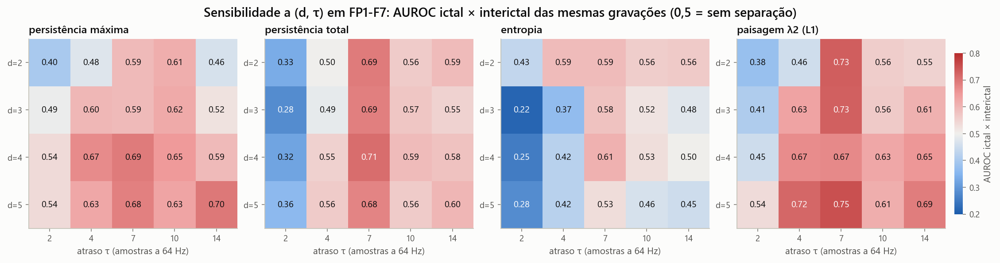

### 6. Previsão (exploratória)

Definições: horizonte pré-ictal de 600 s, tempo de intervenção 0 s, exclusão
pós-ictal de 600 s, escore suavizado por 60 s (causal), período refratário de 600 s,
alarme falso = alarme em janela interictal, 6,31 h interictais.

- Janela a janela, a AUROC pré-ictal × interictal é 0,80 com todas as gravações, mas
  0,56 e 0,58 **dentro** de cada gravação com crise: o escore não distingue os 10 min
  anteriores à crise do resto da mesma hora.
- No melhor limiar, as duas crises são "previstas" com 0,63 alarme falso por hora.
  Esse número é otimista por dois motivos: o limiar foi varrido nos próprios dados
  de teste, e o escore fica alto durante todo o estado de ~2 h, de modo que o alarme
  dispara a cada 10 min ao longo dele. As duas crises estão no mesmo estado, então
  contam na prática como um único evento.

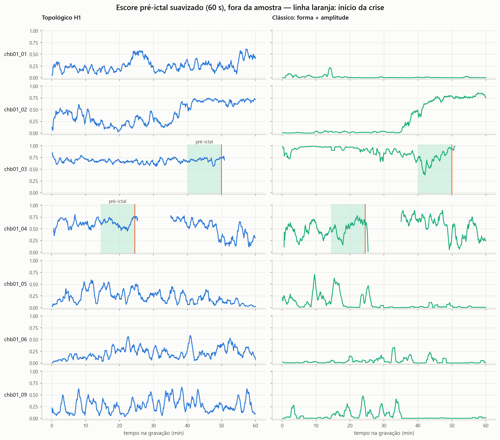

### 7. Mapper (exploratório)

Com lente PCA 2D dos descritores de H1 (63 nós), nenhuma região do grafo concentra
janelas ictais (no máximo 2,4 % de um nó). O que organiza o grafo é o mesmo estado
das gravações 02–04. Com lente de tempo relativo à crise, o grafo é praticamente um
caminho, sem ramificação na crise. Versões interativas:
`resultados/mapper_A_interativo.html` e `mapper_B_interativo.html`.

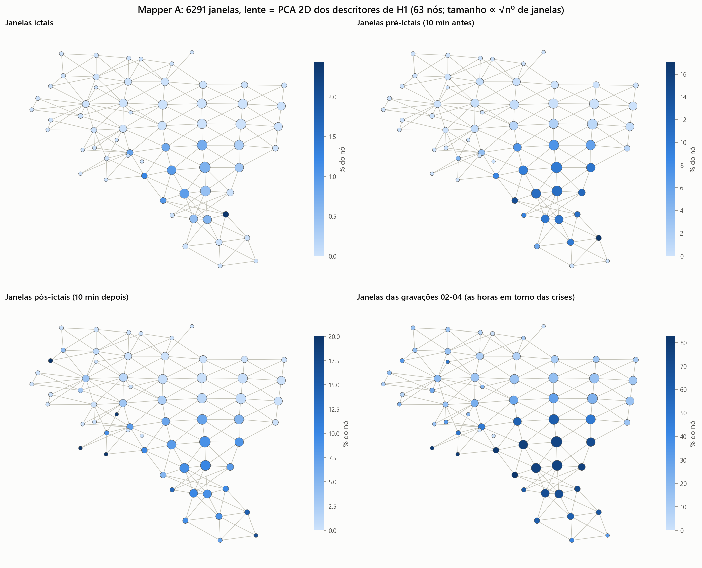

O mesmo Mapper foi repetido nas 40 h do chb01 (`scripts/13`, figura
`resultados/didaticas/D9_mapper_chb01.png`): 110 nós, nenhum com mais de 7,7 % de janelas
de crise, e 110 das 113 janelas de crise do grafo em nós dominados pelo estado lento.
Ver a seção [Tópicos avançados em destaque](#tópicos-avançados-em-destaque).

### 8. Extensão multipaciente (sete pacientes, 21 crises)

Mesmo pipeline e mesmos parâmetros (FP1-F7, d=3, τ=4, janelas de 8 s com passo de
4 s, mesmos rótulos), agora em 92 h de EEG de 7 pacientes com **21 crises** e 310
janelas ictais. Com mais de um paciente dá para fazer a divisão treino/teste **por
paciente** que o enunciado pede.

```
python scripts/10_multipaciente_extrair.py   # ~25 min; um cache por paciente
python scripts/11_multipaciente_analise.py   # ~3 min; saída em resultados/multipaciente/
```

| Paciente | Gravações | Horas | Crises | Janelas ictais |
|---|---|---|---|---|
| chb01 | todas as 42 | 40,5 | 7 | 114 |
| chb02 | 01–19 (com 16 e 16+) | 19,2 | 3 | 44 |
| chb03 | 01–08 | 8,0 | 4 | 61 |
| chb04 | 01–05 | 18,6 | 1 | 13 |
| chb06 | 01 | 4,0 | 3 | 12 |
| chb08 | 02 | 1,0 | 1 | 43 |
| chb12 | 06 | 1,0 | 2 | 23 |

As 7 gravações do estudo de caso, recalculadas pelo código multipaciente, são
idênticas ao cache original (diferença máxima 0).

**AUROC ictal × interictal das mesmas gravações** (comparação justa):

| Descritor | chb01 | chb02 | chb03 | chb04 | chb06 | chb08 | chb12 |
|---|---|---|---|---|---|---|---|
| persistência máxima | 0,50 | 0,62 | 0,41 | 0,34 | 0,45 | 0,49 | 0,49 |
| persistência total | 0,47 | 0,63 | 0,65 | 0,72 | 0,40 | 0,72 | 0,70 |
| paisagem λ2 (L1) | 0,50 | 0,68 | 0,64 | 0,56 | 0,49 | 0,73 | 0,73 |
| *baseline:* log-variância | 0,97 | 0,90 | 0,89 | 0,09 | 0,48 | 0,77 | 0,46 |

- **A persistência máxima não se destaca em nenhuma das 21 crises**: o trecho ictal
  fica entre os percentis 10 e 68 dos blocos interictais de mesma duração do paciente.
- **A amplitude de um canal não é universal.** Nos três primeiros pacientes a
  log-variância destaca todas as crises (percentis 95 a 100). Nos novos, não: no chb04
  a crise tem amplitude *menor* que o interictal da mesma gravação (AUROC 0,09), e no
  chb06 e no chb12 ela fica no nível do interictal (percentis de 6 a 77). No total, a amplitude passa do percentil
  90 em 15 das 21 crises; a topologia, em nenhuma.
- A paisagem λ2 continua inconsistente: percentis de 56 a 93 no chb01, de 40 a 59 no
  chb03 e de 79 a 98 no chb08 e no chb12.

**Classificador (regressão logística), AUROC no paciente testado, deixa-um-paciente-fora:**

| Descritores | chb01 | chb02 | chb03 | chb04 | chb06 | chb08 | chb12 |
|---|---|---|---|---|---|---|---|
| Topológico H1 | 0,73 | 0,62 | 0,61 | 0,67 | 0,53 | 0,79 | 0,45 |
| Clássico: só forma | 0,87 | 0,86 | 0,63 | 0,95 | 0,60 | 0,77 | 0,69 |
| Clássico: forma + amplitude | 0,99 | 0,97 | 0,97 | 0,91 | 0,41 | 0,93 | 0,67 |
| Topológico + clássico | 0,99 | 0,97 | 0,98 | 0,93 | 0,47 | 0,95 | 0,65 |

O baseline de um canal, quase perfeito nos três primeiros pacientes, cai para 0,41 no
chb06 e 0,67 no chb12. A validação dentro do paciente (deixa-uma-gravação-fora) só é
possível no chb01, chb02 e chb03, que têm mais de uma gravação com crise; os números
são os mesmos de antes (topológico 0,74 / 0,58 / 0,56; clássico completo 0,99 / 0,92 / 0,99).


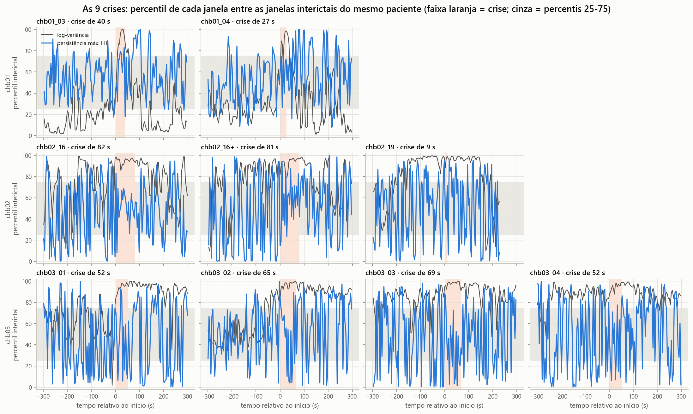
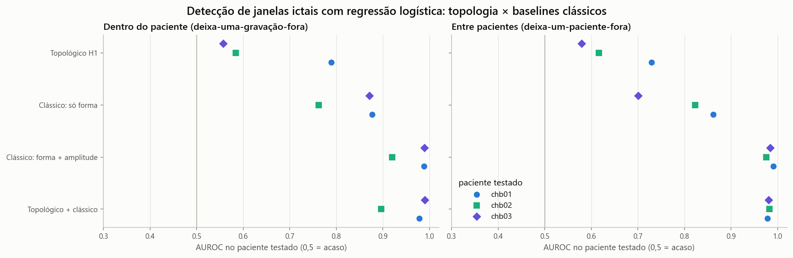


### 9. Definição supervisionada do enunciado (rótulos estritos, avaliação por evento)

```
python scripts/12_avaliacao_supervisionada.py   # ~5 min; usa os caches do script 10
```

Os itens 1 a 8 usam os rótulos fixados no início do projeto (ictal = pelo menos metade
da janela na crise; interictal = tudo fora das faixas de 10 min). O script 12 refaz a
detecção com a versão recomendada no enunciado:

| Rótulo | Regra | Janelas (chb01 / 02 / 03 / 04 / 06 / 08 / 12) |
|---|---|---|
| ictal (y=1) | janela totalmente contida na crise anotada | 100 / 38 / 53 / 11 / 6 / 41 / 19 |
| interictal (y=0) | a 1 h ou mais de qualquer crise do paciente | 26 221 / 13 599 / 3 044 / 15 445 / 0 / 0 / 0 |
| pré-ictal (só na extensão de 3 classes) | janela contida em [ts − 600 s, ts) | 976 / 442 / 531 / 149 / 445 / 148 / 296 |
| sem rótulo | cruza o início ou o fim da crise, pós-ictal, interictal próximo | fora do treino e das métricas por janela |

chb06, chb08 e chb12 têm uma gravação só e nenhuma janela a 1 h das crises. Neles dá
para medir a sensibilidade por crise, mas não a AUROC nem os alarmes falsos.

O limiar de alarme é **fixado no treino**: o valor que deixa passar 1 % (ou 0,1 %) das
janelas negativas de treino. Com passo de 4 s, 1 % equivale a cerca de 9 janelas
positivas por hora.

**Entre pacientes (deixa-um-paciente-fora), 21 crises no teste:**

| Descritores | Crises detectadas, 1 % | Alarmes falsos/h, 1 % (chb01 / 02 / 03 / 04) | Crises detectadas, 0,1 % | Alarmes falsos/h, 0,1 % |
|---|---|---|---|---|
| Topológico H1 | 4 de 21 | 6,1 / 7,4 / 8,0 / 17,0 | 0 de 21 | 0,5 / 0,0 / 0,6 / 7,2 |
| Clássico: só forma | 9 de 21 | 7,5 / 15,6 / 4,4 / 11,4 | 1 de 21 | 0,3 / 1,2 / 1,5 / 3,0 |
| Clássico: forma + amplitude | 18 de 21 | 5,4 / 12,2 / 0,0 / 4,4 | 13 de 21 | 0,3 / 1,9 / 0,0 / 0,4 |
| Topológico + clássico | 21 de 21 | 9,8 / 15,7 / 0,3 / 5,5 | 16 de 21 | 0,9 / 2,5 / 0,0 / 1,1 |

- Sozinho, o modelo topológico detecta 4 das 21 crises no ponto de 1 % e nenhuma no de 0,1 %.
- O clássico completo perde 3 crises: duas do chb06 e uma do chb12, os pacientes em
  que a amplitude deste canal não muda na crise.
- O atraso mediano de detecção do clássico completo é de 9 s (1 %) e 14 s (0,1 %).

**Somar a topologia ao baseline ajuda, e o ganho não é artefato.** Com os 15
descritores de H1 somados aos 12 clássicos, as 21 crises são detectadas no ponto de
1 %, incluídas as três que o clássico perde, e 16 no de 0,1 %. O preço é mais alarme
falso (por exemplo, 5,4 → 9,8 por hora no chb01). No controle, os descritores de H1 são
embaralhados dentro de cada paciente (20 repetições): se o ganho viesse só de ter mais
colunas, a versão embaralhada ganharia o mesmo, e não ganha.

| AUPRC entre pacientes | chb01 | chb02 | chb03 | chb04 |
|---|---|---|---|---|
| Clássico: forma + amplitude | 0,67 | 0,25 | 0,95 | 0,015 |
| Clássico + topologia | 0,76 | 0,47 | 0,99 | 0,027 |
| Clássico + topologia embaralhada (máximo de 20) | 0,67 | 0,28 | 0,96 | 0,023 |

A topologia não serve de detector sozinha, mas não é redundante com os descritores
clássicos. Com 21 crises, é um indício consistente, ainda não um resultado fechado.

**Cronológica, no mesmo paciente** (treino até a gravação da crise ⌊n/2⌋, teste nas
posteriores):

| Paciente | Crises no teste | Topológico H1 | Clássico: forma + amplitude |
|---|---|---|---|
| chb01 | 4 | AUROC 0,72; 2 de 4 detectadas (1 %) e 1 de 4 (0,1 %) | AUROC 1,00; 4 de 4; 24 alarmes falsos/h (1 %) e 7 (0,1 %) |
| chb02 | 2 | AUROC 0,73; 0 de 2 | AUROC 0,94; 2 de 2; 16 alarmes falsos/h (1 %) e 7 (0,1 %) |
| chb03 | 2 | não avaliável | não avaliável |
| chb04, chb06, chb08, chb12 | — | não avaliável | não avaliável |

O teste cronológico não é possível em cinco pacientes: no chb03 as gravações de treino
não têm interictal a 1 h das crises; o chb04 e o chb08 têm uma crise só; o chb06 e o
chb12 têm uma gravação só. A regra não foi afrouxada depois de ver os dados.

**Três classes, entre pacientes.** Nos quatro pacientes com as três classes, a
acurácia balanceada (acaso = 0,33) vai de 0,30 a 0,50 com a topologia e de 0,48 a 0,65
com o clássico, que acerta a classe ictal. A AUROC de "pré-ictal × resto" vai de 0,29 a
0,63 com a topologia e de 0,42 a 0,58 com o baseline, sem direção consistente entre
pacientes. Não há evidência de antecipação.

As saídas por janela (escore e classe prevista; 3 probabilidades na extensão) ficam em
`resultados/multipaciente/tabelas/saida_*_por_janela.csv.gz`.

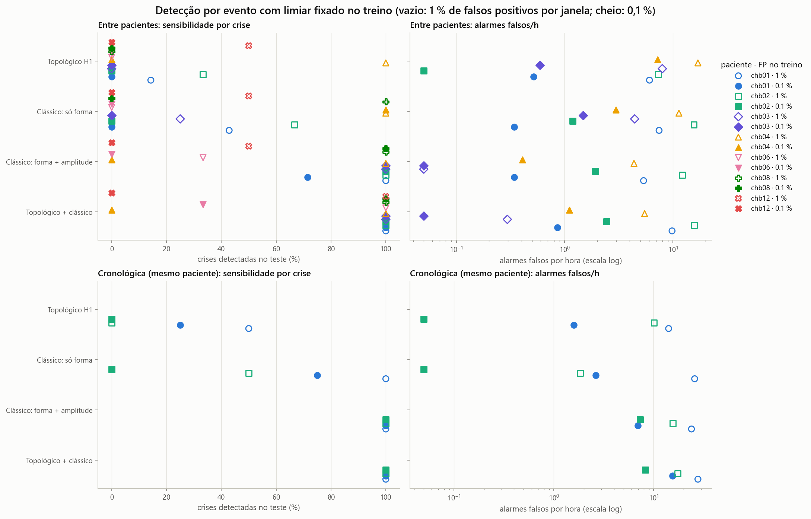

### 10. O estado lento em 40 horas e as figuras didáticas

```
python scripts/13_figuras_didaticas.py   # ~1 min; saída em resultados/didaticas/
```

O estudo de caso (item 3) encontrou um "estado" de cerca de 2 h, com persistência
total alta, que continha as duas crises. Com o chb01 inteiro dá para ver o que ele é:

- o estado (mediana móvel de 5 min da persistência total acima de 3,3) ocupa **46 % das
  40 h** e aparece nas duas noites e no início da tarde;
- **as 7 crises do paciente caem dentro dele**; se caíssem ao acaso, a chance seria de
  0,46⁷ ≈ 0,5 %;
- nas mesmas faixas a amplitude (log-variância) fica baixa.

Sono é a hipótese mais plausível, mas não há hipnograma para confirmar. A leitura é a
do item 3, agora com mais base: a persistência total acompanha um estado do cérebro em
que as crises deste paciente acontecem; ela não marca a crise. Dentro do estado, o
trecho da crise não se destaca (AUROC 0,47 contra o interictal das mesmas gravações),
e o chb02 tem um platô igual, à noite, sem nenhuma crise dentro.

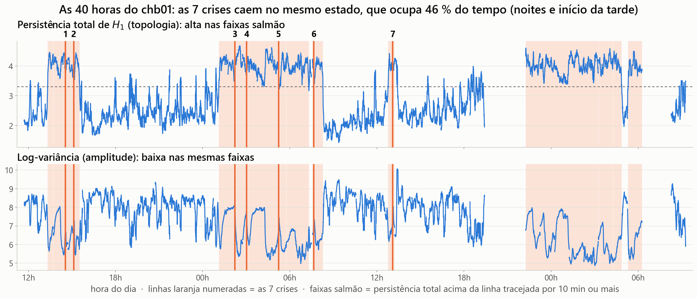

As outras figuras de `resultados/didaticas/` foram feitas para a apresentação, com a
leitura escrita na própria figura:

| Figura | O que explica |
|---|---|
| `D1_como_ler_diagrama.png` | do laço à barra e ao ponto do diagrama de persistência |
| `D2_expectativa_realidade.png` | o que a hipótese previa × o que o EEG mostra na crise |
| `D3_o_que_e_auroc.png` | a AUROC, com as janelas do estudo de caso |
| `D4_todas_as_crises.png` | as 21 crises, uma por linha: topologia × amplitude |
| `D5_crises_detectadas.png` | treino e teste por paciente: uma bolinha por crise |
| `D7_ml_como_foi_feito.png` | o tópico de ML: da janela ao alarme e como o modelo é testado |
| `D8_mapper_como_funciona.png` | o Mapper passo a passo: lente, cobertura, grupos e grafo |
| `D9_mapper_chb01.png` | o Mapper nas 40 h do chb01: o grafo segue o estado, não a crise |

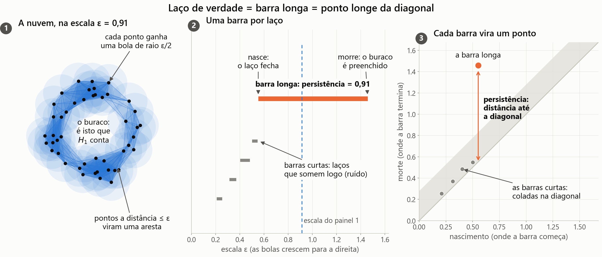

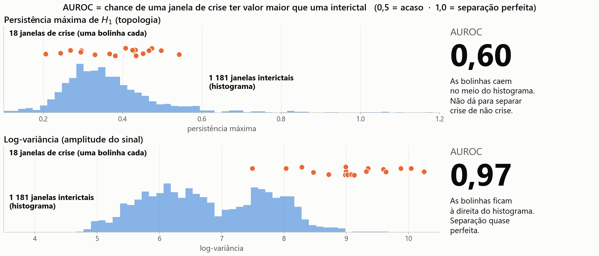


### 11. Vários canais ao mesmo tempo

```
python scripts/14_multicanal.py   # ~12 min (Ripser); usa todos os EDF
```

O enunciado pede um canal. Como extensão, o mesmo pipeline (Takens d=3, τ=4 → Rips →
H1) foi aplicado a cada um dos 21 canais bipolares distintos, nos sete pacientes, e os
descritores entraram juntos no modelo. Duas formas de juntar: **concatenados** (uma
coluna por canal e descritor) e **agregados** (média, máximo, mínimo e desvio-padrão de
cada descritor entre os canais, o que não depende de qual canal é qual). Rótulos,
partições e limiar são os do item 9.

| Descritores (teste no paciente que ficou de fora) | Crises detectadas, 1 % | Alarmes falsos/h, 1 % (chb01 / 02 / 03 / 04) | Crises detectadas, 0,1 % |
|---|---|---|---|
| Topologia, 1 canal (FP1-F7) | 4 de 21 | 6 / 7 / 8 / 17 | 0 de 21 |
| Topologia, 21 canais concatenados | 9 de 21 | 12 / 11 / 28 / 22 | 1 de 21 |
| Topologia, 21 canais agregados | 12 de 21 | 4 / 11 / 21 / 8 | 0 de 21 |
| Clássico só forma, 21 canais agregados | 14 de 21 | 11 / 17 / 6 / 10 | 0 de 21 |
| Clássico com amplitude, 1 canal (FP1-F7) | 18 de 21 | 5 / 12 / 0 / 4 | 13 de 21 |
| Clássico com amplitude, 21 canais agregados | 21 de 21 | 33 / 45 / 0 / 3 | 21 de 21 |
| Topologia + clássico, 21 canais agregados | 21 de 21 | 20 / 52 / 0 / 5 | 21 de 21 |

- **Vários canais triplicam o que a topologia detecta**: de 4 para 12 crises. A forma
  agregada se transfere melhor entre pacientes que a concatenada, que decora o treino
  (AUROC de treino 0,95).
- **Continua longe do baseline**: no limiar mais rígido (0,1 %) a topologia agregada
  não detecta nenhuma crise, e o clássico com 21 canais detecta as 21.
- **Vários canais resolvem os pacientes difíceis**: as crises do chb06 e do chb12, que
  o clássico de um canal perde, são detectadas com os 21 canais. O custo são mais
  alarmes falsos no chb01 e no chb02.
- **Nenhum canal sozinho resolve com a topologia**: a AUROC da persistência máxima vai
  de 0,38 a 0,64 entre os 21 canais nos quatro pacientes em que dá para medir; a da
  log-variância, de 0,68 a 1,00.

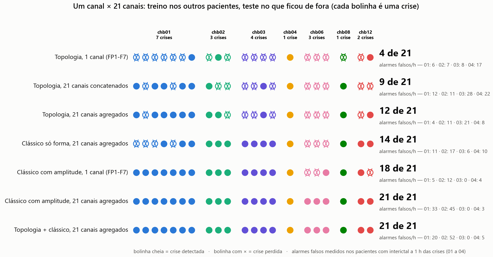

## Animações

- `resultados/animacoes/animacao_filtracao_rips.gif` — as bolas crescem, surgem
  arestas e triângulos e o código de barras de H1 é desenhado junto (sinal sintético,
  d=2, 43 pontos, para caber no plano).
- `resultados/animacoes/animacao_janela_deslizante.gif` — o pipeline no EEG real em
  torno da crise de chb01_03: janela → nuvem de Takens → diagrama → persistência máxima.
- `resultados/figuras/09_filtracao_quadro{1..4}.png` — quadros-chave para slides.

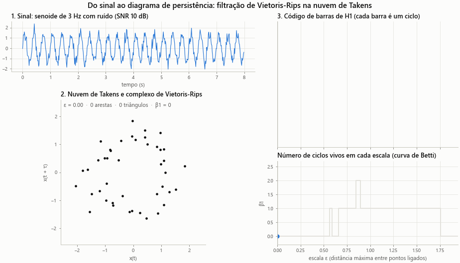


## Limitações

- **Sete pacientes, 21 crises.** Nada aqui é confirmatório; o CHB-MIT tem 24 casos.
  Três dos sete pacientes entram com uma gravação só, o que impede medir neles a AUROC
  e os alarmes falsos com a regra de 1 h.
  Os itens 1 a 7 usam só 7 h do chb01, com divisão por gravação (generalização para
  outras horas do mesmo paciente); a divisão por paciente está nos itens 8 e 9. A
  previsão com alarmes (item 6), o Mapper (item 7) e a sensibilidade a canal e (d, τ)
  (item 5) continuam só nessas 7 h. Do chb03 entraram 4 das 7 crises; do chb04, 1 de 4;
  do chb06, 3 de 10; do chb08, 1 de 5; do chb12, 2 de 40.
- **Janelas correlacionadas.** Janelas vizinhas se sobrepõem em 50 %; por isso os
  resultados são dados como AUROC e percentis de blocos, não como valores-p de testes
  que supõem independência. A faixa de erro das paisagens médias é otimista.
- **"Interictal" frouxo nos itens 1 a 8.** Qualquer janela fora das faixas
  pré/pós-ictais conta como interictal. O item 9 exige 1 h de distância, ainda menos
  que as 4 h comuns na literatura.
- **Um canal por vez nos itens 1 a 10.** A crise pode ter foco longe do canal
  analisado; o item 5 cobre os outros canais de forma univariada e o item 11 junta os
  21 no mesmo modelo, mas só com agregações simples entre canais.
- **Nuvens de 126 pontos** (subamostragem de 4): ciclos mais finos que isso não são
  resolvidos.
- **Sem rejeição de artefatos.** Piscadas e movimentos entram nas janelas e geram
  pontos atípicos na nuvem; um próximo passo natural seria remover artefatos ou usar
  uma filtração robusta a outliers (por exemplo, distância à medida) antes de H1.

## Reprodutibilidade

Semente única em `tda_eeg/config.py`; parâmetros fixados antes de qualquer métrica de
desempenho; versões em `requirements.txt` e `resultados/pip_freeze.txt`; saída de cada
etapa em `resultados/registro_execucao.txt`. A varredura de sensibilidade usa o
Ripser em vez do GUDHI por velocidade; os dois dão a mesma persistência (diferença
máxima 3×10⁻⁷ em 60 janelas).
